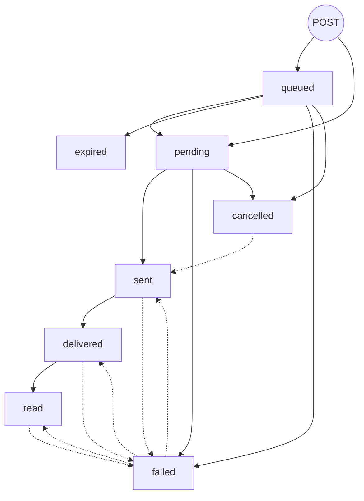

A message you send with [`POST /v1/messages`](/api-reference/messages/send) moves through a small set of statuses. The `202 Accepted` response only means iBubbl has the message. It goes out later, from the Mac that runs your line, and its status keeps changing after that.

Read the current status at any time with [`GET /v1/messages/{id}`](/api-reference/messages/retrieve), or follow it with [webhooks](/webhooks/events).

## The diagram

Solid arrows are the normal path. Dashed arrows are the [moves that go backwards](#statuses-that-move-backwards), which are rare.

## Statuses

| Status | Description | Is final? | Webhook emitted |
| ------ | ----------- | --------- | --------------- |
| `queued` | Accepted, but parked by a capacity hold. Today that means your line's Mac is offline (`line_offline`). One-to-one messages only. iBubbl retries every 30 seconds. | No | `message.queued` with `status: "queued"`, at acceptance |
| `pending` | Accepted and waiting for your line's Mac to send it. This includes a message being [held](#held-messages) for the contact's sending hours or the hourly new-contact limit. | No | `message.queued` with `status: "pending"`, at acceptance (one-to-one only) |
| `sent` | Your line sent it. | No | `message.sent` |
| `delivered` | The recipient's device confirmed delivery. | No | `message.delivered` |
| `read` | The recipient read it. A read is reported only when the recipient has read receipts on, and a plain SMS never reports one. | **No.** A late iMessage error can still turn it into `failed`, if no delivery receipt was recorded. | `message.read` |
| `failed` | It didn't go out, or iMessage reported it undeliverable. `failed_reason` says why. That includes a `queued` message the queue's retry fails. | **Usually.** A failure with an `imessage_*` reason moves to `delivered` or `read` if Apple later confirms the message. A few connection failures can move to `sent` if the Mac confirms the send late (see below). | `message.failed`, with `failed_reason` |
| `expired` | It was still `queued` about an hour after it was accepted, so iBubbl dropped it (`failed_reason: "queue_expired"`). | **Yes** | `message.failed`, with `status: "expired"` and `failed_reason: "queue_expired"` |
| `cancelled` | Stopped before it went out: with [Cancel a message](/api-reference/messages/cancel), by someone on your account in the dashboard, or by iBubbl when an [after-hours auto-reply](/concepts/after-hours-reply) misses its window. | **Almost.** It moves to `sent` only if your line had already sent it when the cancel arrived. | `message.cancelled` (it carries no reason) |

<Note>
`message.queued` fires once, when a one-to-one message is accepted, whether it starts as `queued` or `pending`. It does not fire again when a `queued` message moves to `pending`. Group sends never fire it.
</Note>

## Held messages

A `pending` message can wait before it goes out. `GET /v1/messages/{id}` shows why with two fields:

- `held_reason` is `working_hours` (outside the contact's [sending hours](/concepts/working-hours)) or `hourly_limit` (the line has used its [hourly new-contact limit](/concepts/limits)).
- `held_until` is when it is expected to go out. It is `null` when there is no estimate: for example, when no sending day is enabled.

Both are `null` when the message isn't held. iBubbl marks holds within about 10 seconds of accepting a message, so the `202` response and an immediate `GET` usually show `null`. A held message has no separate status or webhook: you get `message.sent` when it goes out.

## Scheduled messages

A [scheduled message](/guides/schedule-messages) isn't a message until its `send_at`. Until then it's a scheduled message with statuses of its own (`scheduled`, `sending`, `fired`, `failed`, `cancelled`) and events of its own (`scheduled_message.*`). When it fires, iBubbl creates a normal message and the scheduled message's `message_id` points to it. From there the message follows this page like any other, starting at `pending` or `queued`, and it can still be held for sending hours. A scheduled message refused when it fires creates no message at all: you get [`scheduled_message.failed`](/webhooks/events#scheduled-message-failed), not `message.failed`.

## Edits and Undo Send

[Editing](/api-reference/messages/edit) or [unsending](/api-reference/messages/unsend) a message you sent doesn't change its `status`: it stays `sent`, `delivered` or `read`. Their progress has fields of its own on the message:

- `edit_status` is `pending` while an edit is on its way, then `edited` (with `edit_count` and `edited_at`) or `failed`. Events: `message.edited` and `message.edit_failed`.
- `unsend_status` is `pending` while an Undo Send is on its way, then `unsent` (with `unsent_at`, and `body` empty), `partly_unsent` or `failed`. Events: `message.unsent` and `message.unsend_failed`.

A message you received shows the contact's own edits and unsends the same way (`edited`, `unsent` or `partly_unsent`). See [Edit, Undo Send and Cancel](/guides/editing-and-unsending).

## Events that don't fire

These changes happen without a webhook. If you need to know about them, poll `GET /v1/messages/{id}`, or list recent messages with [`GET /v1/messages`](/api-reference/messages/list), which returns each one's current status. To catch up on webhooks you missed, see [Recover from downtime](/guides/webhook-retries#recover-from-downtime).

- **`queued` → `pending`.** The capacity hold cleared and the message is on its way. The next event is `message.sent`.
- **A group send is accepted.** Groups never fire `message.queued`. Their first event is `message.sent`.
- **A read receipt marks earlier messages read.** When the recipient reads a message, iBubbl also marks your earlier `sent` and `delivered` messages in that conversation `read`, but `message.read` fires only for the message the receipt was about.
- **A failed message heals straight to `delivered` or `read`.** You get `message.delivered` or `message.read`, with no `message.sent` before it.

A `queued` message that ends without going out always fires `message.failed`. One still `queued` 60–65 minutes after it was accepted expires: the event carries `status: "expired"` and `failed_reason: "queue_expired"`, and its `idempotency_key` is released, so send it again if it still matters. One the queue's retry fails carries `status: "failed"` and the reason.

A `pending` message never becomes `expired`. If its line's Mac has been offline for more than an hour, it moves to `failed` with `failed_reason: "agent_offline"`, and `message.failed` fires.

## Statuses that move backwards

Most messages only move forward. The exceptions:

- **`sent`, `delivered` or `read` → `failed`.** Messages.app can report an iMessage error after the message left your line: for example, the number isn't on iMessage. The message becomes `failed` with `failed_reason` `imessage_undeliverable` or `imessage_error:<code>`. This happens only when no delivery receipt was recorded.
- **`failed` → `delivered` or `read`.** If a message that failed with an `imessage_*` reason is later confirmed by Apple, it moves to `delivered` or `read`.
- **`failed` → `sent`.** A message failed as `line_inactive` or `agent_offline`, or as `mac_send_failed` / `bluebubbles_unreachable` within 30 minutes, moves to `sent` if the Mac reports that it did send it after all. `message.sent` fires.
- **`cancelled` → `sent`.** The Mac had already sent it when the cancel arrived. `message.sent` fires.

Order events by the envelope's `created_at`, and when in doubt treat `GET /v1/messages/{id}` as the truth. See [ordering and duplicates](/webhooks/events#ordering-and-duplicates).

## Duplicates and retries

### What the idempotency key does

Every send carries a required `idempotency_key`. Keys are scoped to your iBubbl account, shared by all of its API keys, and never expire. Full rules: [Idempotency](/idempotency).

| Earlier message with this key | Same key, same request | Same key, different request |
| ----------------------------- | ---------------------- | --------------------------- |
| None | Sent as a new message | — |
| `failed` or `expired` | The key is released: sent as a **new** message, with a new `id` | `409 idempotency_conflict` |
| Any other status, **including `cancelled`** | Nothing is sent. `202` with the original message, showing its **current** status | `409 idempotency_conflict` |

### There is no content deduplication

iBubbl never compares message bodies. Nothing in the API, the queue or the Mac drops a message because an identical one was sent a moment ago. **A new `idempotency_key` with an identical body sends a second, real message, even milliseconds after the first.** The idempotency key is the only thing that prevents duplicates.

### Avoid retry storms

- Generate the key **once per logical message, before the first attempt**, and store it with the message in your system. Never generate it inside the retry loop.
- Retry only network errors, timeouts and `5xx` responses, with the same key and the identical request body.
- Cap the attempts (3 to 5 is plenty) and back off between them: 1 s, 2 s, 4 s.
- Don't retry `4xx` responses. They create no message, and repeating them won't change the answer. See [Errors](/errors).
- If several workers can send the same message, make sure they share the stored key, rather than each generating its own.

### After a timed-out request

If your request timed out, you don't know whether iBubbl accepted it. **Send it again with the same key and the same body.** If the first request was accepted, you get `202` with that message and nothing is sent twice. If it wasn't, this request sends it once. Either way the contact gets one message.

### Two known edge cases

<Warning>
**Two simultaneous requests with the same key.** If two requests with one key arrive at the same moment (for example, a retry fired while the first request is still running), one of them can return `500 internal_error`. Only one message is created. Retry the failed one with the same key: it returns the `202` replay.
</Warning>

<Warning>
**New groups (`participant_phones`).** For a send that creates a new group, the key is attached just after the message is created. If such a request times out, a retry can create a **second group and a second message**. Don't retry a timed-out `participant_phones` send automatically. First wait for its `message.sent` webhook (its `to_number` is the group's first participant), or check the conversation in the dashboard. Sends into an existing group (`chat_guid`) and one-to-one sends are not affected.
</Warning>

## Next

- [Limits and queues](/concepts/limits): what holds or refuses a send.
- [Lines and routing](/concepts/lines-and-routing): which line sends, and whether it goes as iMessage or SMS.
- [Webhook events](/webhooks/events): the payload of every event above.
- [Schedule messages](/guides/schedule-messages): what happens before a scheduled message becomes a message.
