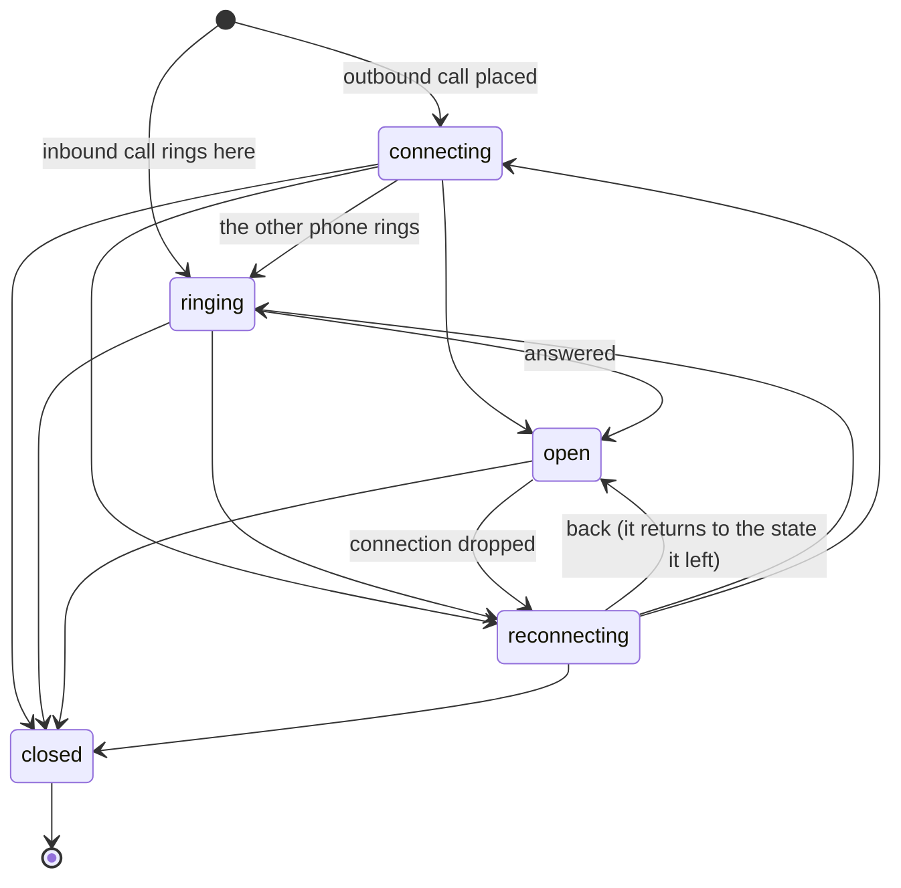

The embeddable dialer is a small calling page you load in an `<iframe>` in your own app, such as your CRM. Your reps make and take phone calls on your iBubbl lines there: outgoing calls show your line's number, and calls to your lines ring in every open dialer.

<Note>
The embeddable dialer is turned on per account. Ask [support](mailto:support@ibubbl.com) to turn it on. Until then, [Create a dialer session](/api-reference/dialer/create-session) answers `403 dialer_not_enabled`.
</Note>

## How it works

1. **Your server creates a session.** It calls [Create a dialer session](/api-reference/dialer/create-session) with your API key and the origins of the pages that will show the dialer. Your API key never reaches a browser.
2. **Your page loads the session's `url`** in an `<iframe>`. The URL works once and must be loaded within 5 minutes, so create a session each time you render the page.
3. **The rep clicks Start dialer.** The browser asks for the microphone. The dialer then shows **Ready**, and calls to your lines ring there.
4. **The dialer works until the session ends,** when its time runs out or you [end it](/api-reference/dialer/end-session). A call in progress is never cut: the dialer stops once the call ends.

## 1. Create a session on your server

Create one session per page view, for the rep who is viewing it. `frame_ancestors` lists the origins of the pages that will embed the dialer: scheme, host and port, with no path. `https://` origins only, except `http://localhost` and `http://127.0.0.1` for development.

<CodeGroup>

```bash cURL
curl -X POST https://api.ibubbl.com/v1/dialer/sessions \
  -H "Authorization: Bearer $IBUBBL_API_KEY" \
  -H "Content-Type: application/json" \
  -d '{
    "frame_ancestors": ["https://crm.example.com"],
    "external_user_id": "user_8231"
  }'
```

```typescript TypeScript
const res = await fetch("https://api.ibubbl.com/v1/dialer/sessions", {
  method: "POST",
  headers: {
    Authorization: `Bearer ${process.env.IBUBBL_API_KEY}`,
    "Content-Type": "application/json",
  },
  body: JSON.stringify({
    frame_ancestors: ["https://crm.example.com"],
    external_user_id: "user_8231",
  }),
  signal: AbortSignal.timeout(10_000),
});

const data = await res.json();
if (!res.ok) throw new Error(`${res.status} ${data.detail?.error}`);
// Hand data.url to the page you are rendering. Don't log it: it is a
// one-time credential for the next 5 minutes.
```

```python Python
import os

import requests

API_KEY = os.environ["IBUBBL_API_KEY"]

res = requests.post(
    "https://api.ibubbl.com/v1/dialer/sessions",
    headers={"Authorization": f"Bearer {API_KEY}"},
    json={
        "frame_ancestors": ["https://crm.example.com"],
        "external_user_id": "user_8231",
    },
    timeout=10,
)
data = res.json()
if not res.ok:
    raise RuntimeError(f"{res.status_code} {data['detail']['error']}")
# Hand data["url"] to the page you are rendering. Don't log it: it is a
# one-time credential for the next 5 minutes.
```

</CodeGroup>

The session lasts 8 hours unless you set `ttl_seconds` (300 to 86400). `external_user_id` is your own ID for the rep: iBubbl stores it with the session and doesn't interpret it.

## 2. Load the dialer in an iframe

```html
<iframe
  src="SESSION_URL"
  allow="microphone; autoplay"
  title="iBubbl dialer"
  style="width: 360px; height: 620px; border: 0;"
></iframe>
```

- **`allow="microphone; autoplay"` is required.** Without it the browser blocks the microphone, and the dialer shows **Microphone blocked**. If your page sends a `Permissions-Policy` header, it must not turn the microphone off.
- **Use the URL exactly as returned, once.** The part after `#` is a single-use launch token. A second load of the same URL shows **Link already used**; one loaded after 5 minutes shows **Link expired**.
- **The page must be on one of `frame_ancestors`.** Anywhere else the dialer shows **Not allowed here** and the link stays usable where it belongs. Opened on its own, outside a page, it shows **Open the dialer inside your CRM**.
- **Size.** It works from about 320 × 520 pixels.

To pre-fill a number in the keypad, add `&to=` and the URL-encoded E.164 number to the end of the URL, for example `&to=%2B14155551234`. The rep still presses Call.

## Or: the drop-in dock

Instead of placing the iframe yourself, add the dock: a phone button that floats in a corner of your app and opens into the dialer. It needs no space in your layout, keeps ringing while collapsed, and gets a new session by itself when one ends. You write one server endpoint, the same session call as step 1, and add two script tags.

### Your endpoint

The dock calls your endpoint whenever it needs a session: on each page load and when a session ends. Your endpoint creates one, exactly as in [step 1](#1-create-a-session-on-your-server), and returns its `url` as text. When iBubbl refuses, pass its answer on unchanged (the status, the JSON body and `Retry-After`), so the dock can tell a refusal that a retry fixes from one that it doesn't; see [When the dock cannot get a session](#when-the-dock-cannot-get-a-session). Protect the endpoint like the rest of your app: anyone who can call it gets a dialer on your lines.

<CodeGroup>

```typescript Node (Express)
app.post("/api/ibubbl-session", requireSignedInRep, async (req, res) => {
  const r = await fetch("https://api.ibubbl.com/v1/dialer/sessions", {
    method: "POST",
    headers: {
      Authorization: `Bearer ${process.env.IBUBBL_API_KEY}`,
      "Content-Type": "application/json",
    },
    body: JSON.stringify({
      frame_ancestors: ["https://crm.example.com"],
      external_user_id: req.user.id,
    }),
    signal: AbortSignal.timeout(10_000),
  });
  const data = await r.json().catch(() => ({ detail: { error: "internal_error" } }));
  if (!r.ok) {
    // iBubbl's refusal, unchanged: the dock reads its code and Retry-After.
    const retryAfter = r.headers.get("Retry-After");
    if (retryAfter) res.set("Retry-After", retryAfter);
    return res.status(r.status).json(data);
  }
  res.set("Cache-Control", "no-store").type("text/plain").send(data.url);
});
```

```python Python (Flask)
@app.post("/api/ibubbl-session")
@login_required
def ibubbl_session():
    r = requests.post(
        "https://api.ibubbl.com/v1/dialer/sessions",
        headers={"Authorization": f"Bearer {API_KEY}"},
        json={
            "frame_ancestors": ["https://crm.example.com"],
            "external_user_id": current_user.id,
        },
        timeout=10,
    )
    if not r.ok:
        # iBubbl's refusal, unchanged: the dock reads its code and Retry-After.
        headers = {"Retry-After": r.headers["Retry-After"]} if "Retry-After" in r.headers else {}
        return r.content, r.status_code, {"Content-Type": "application/json", **headers}
    return r.json()["url"], 200, {"Content-Type": "text/plain", "Cache-Control": "no-store"}
```

</CodeGroup>

Return a new URL on every call: each one works once. Don't log it.

### The script

```html
<script src="https://ibubbl-dashboard.vercel.app/embed/v1/dock.js"></script>
<script>
  IbubblDock.mount({
    // Return the response itself: its text is the URL, and a refusal is read from it.
    getSessionUrl: () => fetch("/api/ibubbl-session", { method: "POST" }),
  });
</script>
```

Returning the response needs version 1.1.0 or later of the dock. With version 1.0.0, return `r.text()` and throw when `!r.ok`; the dock then retries every failure the same way.

`/embed/v1/dock.js` always serves the latest version 1 of the dock, so you get compatible fixes within minutes. To pin an exact version instead, load a numbered file with its integrity hash:

```html
<script
  src="https://ibubbl-dashboard.vercel.app/embed/v1.1.1/dock.js"
  integrity="sha384-cViB5dyuUzre0hg6ZynPSGXBCA15pUJcSACMODtn2QkdGPREvJO1bBrqaXECGJVp"
  crossorigin="anonymous"
></script>
```

A numbered file never changes. Versions 1.1.0 (`sha384-BFJAiUDO8O7SWd9pLb7nhIBubLNi7mD4YEH7eTyjodnMR5lortIU1dyjZVqU2D9M`) and 1.0.0 (`sha384-qzizEpjtdGVNChNbx9QPdeydeisJ7fqDunJf1RdmVJCZN2Eyxj1ureFYyrEKxpSM`) stay available. Newer ones are listed in the [changelog](/changelog).

The dialer's [session options](#session-options) (ringtone, media region, debug logs) are set by your server when it creates the session, so the dock needs nothing for them, and `onEvent` receives `ibubbl:log` with every version of the dock.

### Options

| Option | Default | |
|--------|---------|---|
| `getSessionUrl` | required | A function returning the session `url` (a string, `{ url }`, or a promise of either). Since 1.1.0 it can also return your endpoint's `fetch` response as it is, return `{ error: "<code>" }`, or throw an `Error` with a `code`. Called on mount and each time the session must be renewed. It gets 15 seconds, including reading the response. |
| `position` | `"bottom-right"` | Or `"bottom-left"`. |
| `zIndex` | `2147483000` | The dock's stacking order, if your own overlays must sit above it. |
| `theme` | `"auto"` | `"light"`, `"dark"`, or `"auto"` to follow the computer's setting. It styles the dock and the dialer inside it. |
| `accentColor` | `"#2563EB"` | Any CSS color, used for the button and the dock's header. The icon and text on it switch between black and white to stay readable. |
| `notifications` | `false` | Show a system notification for an incoming call while your page is in the background, one per call. It uses your page's notification permission. Browsers ask for it only after a click on your page, so until the rep decides, the dock's header shows **Turn on alerts**. You can also call `IbubblDock.enableNotifications()` from a button of your own. |
| `singleTab` | `true` | Run one dialer per browser, not one per tab. See [More than one tab](#more-than-one-tab). |
| `onEvent` | — | Receives every message from the dialer, as listed in [Messages between your page and the dialer](#messages-between-your-page-and-the-dialer) and [Call state, quality and errors](#call-state-quality-and-errors). Since 1.1.0, also the dock's own problems, as `ibubbl:error` with `source: "dock"` (see [When the dock cannot get a session](#when-the-dock-cannot-get-a-session)). |

### Methods

| Method | |
|--------|---|
| `IbubblDock.mount(options)` | Adds the dock. Call it once per page; a second call keeps the first dock. |
| `IbubblDock.unmount()` | Removes the dock and its dialer. When the rep signs out, call it and [end the session](/api-reference/dialer/end-session) on your server. |
| `IbubblDock.open()` / `IbubblDock.close()` | Opens or minimizes the panel. |
| `IbubblDock.dial(number)` | Opens the dock with the number in the keypad (a "Call" button on a contact page). The rep still presses Call. |
| `IbubblDock.retry()` | Tries again after the dock gave up connecting. |
| `IbubblDock.enableNotifications()` | Turns on call notifications and asks for the permission if the rep hasn't decided yet. Call it from a click, for example in your settings. Returns a promise of `"granted"`, `"denied"`, `"default"` or `"unsupported"`. |
| `IbubblDock.getState()` | A snapshot: `phase`, `open`, `dialer` (the status below), `ringing`, `inCall`, `role` and, since 1.1.0, `error`: the last problem as `{ code, retryable }`, or `null` once a dialer is ready. |
| `IbubblDock.version` | The dock's version. |

The dock logs its problems to the browser console, prefixed with `[IbubblDock]`. A common one: `getSessionUrl` returned an error page instead of a URL.

### When the dock cannot get a session

When `getSessionUrl` fails, the dock decides from the refusal's code whether to try again. It reports each failure to `onEvent` as `{ type: "ibubbl:error", protocol: 2, source: "dock", code, retryable, message, at }` and in `getState().error`.

| Code | Where it comes from | The dock |
|------|---------------------|----------|
| `unauthorized`, `forbidden`, `dialer_not_enabled`, `account_inactive`, `invalid_frame_ancestors`, `invalid_ttl`, `invalid_external_user_id`, `invalid_edge`, `validation_error`, `not_found` | iBubbl's refusal, passed on by your endpoint | Stops at once and shows **Reconnect** (`retryable: false`): a new attempt can't fix it. Versions 1.1.0 and 1.0.0 of the dock don't know `invalid_edge` and retry it with backoff. |
| `session_refused` | Your endpoint answered 4xx without one of iBubbl's codes (for example the rep's own sign-in expired) | Stops at once (`retryable: false`). |
| `rate_limited` | iBubbl's 429, or your endpoint's | Tries again after `Retry-After`, never sooner than its own backoff. |
| `session_unavailable` | Your endpoint answered 5xx, couldn't be reached, threw, or took longer than 15 seconds | Tries again with backoff (`retryable: true`). |
| `session_url_invalid` | It returned something that isn't a dialer URL, such as an error page | Tries again with backoff. |
| `dialer_unreachable` | The dialer page loaded but never answered (often your Content Security Policy blocking `frame-src`) | Shows **Reconnect**. |
| any other code | Passed on by your endpoint | Tries again with backoff. |

The backoff is 0, 5, 30, 120 and 300 seconds; after that the dock shows **Reconnect**, and `IbubblDock.retry()` starts again.

### What the rep sees

- **The first time,** the dock opens by itself on **Start the dialer**. After the click it says **Ready** and minimizes to its button.
- **The button's dot:** green means Ready, amber means starting or reconnecting, red means the dialer needs attention. Hover over the button to see why.
- **An incoming call** opens the dock by itself, even when it's minimized. When the call ends, or stops ringing without being answered, the dock minimizes again (after a ring that stopped, within about 3 seconds, while the dialer finds out what happened). If the rep minimizes a ringing call, the button pulses until it stops.
- **During a call,** the minimized button shows the call's duration. For an outgoing call, it counts from when the rep pressed Call.
- **If the dialer goes offline,** the dock gives it 15 seconds to reconnect by itself (it usually does, within a second or two) before getting a new session.
- **When a session ends,** the dock gets a new one from your endpoint and reloads the dialer. In Chrome the new dialer starts by itself. When the browser needs another click, Safari usually included, the dock opens on **Start the dialer**. Renewals never interrupt a call: they wait until it ends.
- **If it can't connect** after several tries over about 8 minutes, the dock shows **Reconnect**.

### More than one tab

Reps often have your app open in several tabs. With `singleTab` (the default), only one tab runs the dialer and creates sessions, so a call rings once instead of in every tab. The other tabs show **Calls are on in another tab** and a **Use here** button that moves the dialer to that tab. **Use here** is unavailable while a call rings or is in progress. When the tab with the dialer closes, another tab takes over by itself.

A call rings only in the tab that has the dialer, and the dock can't bring that tab to the front. With `notifications: true`, clicking the notification does.

### Limits of the dock

- **A full page load reloads the dock.** Calls don't ring until it's back, which usually takes a few seconds, and **a call in progress ends**. In an app whose pages change without reloading (React, Vue, and similar), the dock and its calls carry on.
- **Each page load needs the browser's permission again.** Chrome usually starts the dialer by itself once the rep has used your app. Safari may ask for a click, and sometimes for the microphone, on each load.
- **Your Content Security Policy** must allow `https://ibubbl-dashboard.vercel.app` in `script-src` and `frame-src`. If your page sends a `Permissions-Policy` header, it must not turn the microphone off. If your app itself runs inside another page's iframe, each iframe around it needs `allow="microphone; autoplay"`.
- **A changed `theme`** reaches the dialer the next time it loads.

## 3. What the rep sees

The first time, the rep clicks **Start dialer** and allows the microphone. Browsers allow sound and the microphone in an iframe only after a click inside it, so without this click an incoming call couldn't ring. Safari may ask for the microphone again on each page load.

The status line at the top always says whether calls ring there:

| Status | Meaning |
|--------|---------|
| **Ready** | Calls to your lines ring here while this page is open. |
| **Start the dialer** | Waiting for the rep's click. |
| **Connecting…** / **Reconnecting…** | Not ringing yet, or the connection dropped. The dialer retries by itself. |
| **Offline** | The connection is gone. Reload the page. |
| **Can't receive calls** | The dialer couldn't register for incoming calls. Close other dialer tabs of this account, then reload. |
| **Microphone blocked** | The browser or your iframe refused the microphone. |
| **Session ended** | The session expired, or you ended it. Create a new one. |
| **Link already used** / **Link expired** / **Invalid dialer link** | Render the page again, with a new session. |
| **Not allowed here** | This page's origin isn't in `frame_ancestors`. |
| **Calling not enabled** | The dialer isn't turned on for your account. |

From **Ready** the rep can:
- dial from the **Keypad**, or pick someone from **Contacts** (your iBubbl contacts, searched by name or number);
- answer or decline an incoming call;
- during a call: mute, use the keypad to send tones (for phone menus), and hang up.

## Calls

**Incoming calls ring in every open dialer and every open iBubbl dashboard tab of your account at once.** The first to answer takes the call. **Decline** stops only that dialer: the others keep ringing. If nobody answers, the caller reaches your voicemail. Calls ring only while a dialer or dashboard tab is open, so keep the page with the dialer open while reps are taking calls.

**Outgoing calls** show your line's number as the caller ID: the line the contact already talks to, or your oldest active line for a new contact. Dialing a number that isn't one of your contacts yet adds it to your contacts. Calls to numbers outside the US, its territories and Canada, and to premium-rate numbers, are refused before anything is dialed. Every outgoing call is also checked against your [calling limits](#calling-limits) when it starts.

**Which rep handled a call.** Calls placed from a dialer, and inbound calls answered in one, carry that session's `external_user_id` in [List calls](/api-reference/calls/list), [Retrieve a call](/api-reference/calls/retrieve) and the [`call.*` webhooks](/webhooks/events#call-completed), so your CRM can log each call against the right user.

## Messages between your page and the dialer

The dialer tells your page what happens with `postMessage`. It sends them only to the page it started on, the origin in `frame_ancestors` it was loaded under. Check the sender's origin before you trust a message: it is the origin of the session `url`.

| `type` | When | Other fields |
|--------|------|--------------|
| `ibubbl:ready` | The dialer can make and take calls. | `options`: the [session options](#session-options) the dialer applied, `{ play_incoming_ringtone, edge, debug_log }`. A dialer loaded before this field existed sends none. |
| `ibubbl:incoming` | A call is ringing. Sent again when the caller is found in your iBubbl contacts with a name. | `from` (the caller's number, in E.164; when the caller withholds their number, a text such as `anonymous` instead), `contact_name` (the caller's name in your iBubbl contacts, or `null`: also `null` for a named contact the dialer couldn't find, such as one that opted out; to show your CRM's name instead, see [Caller names from your CRM](#caller-names-from-your-crm)), `call_id` (the call's ID, or `null`; see [Open the contact when a call rings](#open-the-contact-when-a-call-rings)) |
| `ibubbl:call-started` | The rep answered, or started a call. | `direction` (`inbound` or `outbound`), `number`, `call_id` (the call's ID on an inbound call, `null` on an outbound one) |
| `ibubbl:call-ended` | The call ended. | `direction`, `number`, `duration_s` (seconds connected, `0` if never answered), `call_id` (as on `ibubbl:call-started`) |
| `ibubbl:session-expired` | The session ended. Create a new one and set the iframe's `src` again. | — |
| `ibubbl:status` | The dialer's status changed. Sent on every change, starting when the dialer loads. | `state`: `start`, `connecting`, `ready`, `reconnecting`, `offline`, `mic-blocked`, `registration-failed`, `session-ended`, `link-used`, `link-expired`, `origin-refused`, `not-enabled`, `account-inactive`, `bad-link` or `not-framed`. The dock also uses a `load` field; ignore it. |
| `ibubbl:incoming-ended` | A call stopped ringing in this dialer. Sent once per call. | `from`, and `reason`: `answered` (answered here; `ibubbl:call-started` follows), `declined` (the rep pressed Decline here), `answered_elsewhere` (another dialer or dashboard tab answered it) or `missed` (anything else: nobody answered, or the dialer couldn't find out). When a call stops ringing without being answered or declined here, the dialer first asks iBubbl what happened, so this message can come up to about 3 seconds after the ring stopped; see [Why a call closed](#why-a-call-closed). `call_id`: the same ID as that call's `ibubbl:incoming`. |

These messages never change: fields are only ever added. The dialer also sends the newer messages in [Call state, quality and errors](#call-state-quality-and-errors).

Your page can send one message: `{ "type": "ibubbl:dial", "to": "+14155551234" }`. It fills the keypad with the number, and the rep presses Call. The dialer accepts it only from the page it started on. A number it can't read fills nothing and is answered with an [`ibubbl:error`](#errors-from-the-dialer) `invalid_number`; a message from any other page is ignored.

```typescript
const dialer = document.querySelector<HTMLIFrameElement>("#ibubbl-dialer")!;
const dialerOrigin = new URL(dialer.src).origin;

window.addEventListener("message", async (event) => {
  if (event.origin !== dialerOrigin) return;
  switch (event.data?.type) {
    case "ibubbl:incoming":
      showToast(`Incoming call from ${event.data.contact_name ?? event.data.from}`);
      break;
    case "ibubbl:call-ended":
      logCall(event.data.direction, event.data.number, event.data.duration_s);
      break;
    case "ibubbl:session-expired":
      dialer.src = await getNewDialerUrl(); // your server creates a new session
      break;
  }
});

// A "Call" button on a contact page: pre-fill the dialer.
function callWithIbubbl(phone: string) {
  dialer.contentWindow?.postMessage({ type: "ibubbl:dial", to: phone }, dialerOrigin);
}
```

`showToast`, `logCall` and `getNewDialerUrl` stand for your own code.

### Open the contact when a call rings

The messages about an inbound call carry `call_id`: the call's ID in iBubbl, the same ID that [Retrieve a call](/api-reference/calls/retrieve) takes and that the [`call.*` webhooks](/webhooks/events#call-completed) carry as `data.id`. Use it to open the caller's record while the phone is still ringing, and to attach the call's outcome to that record when it ends.

1. On `ibubbl:incoming`, send `call_id` to your server. Your server calls `GET /v1/calls/{call_id}` with your API key and gets the call's `contact_id`, `contact_number` and `conversation_id`. The call can already be read while it rings: its `status` is `ringing`. Never put your API key in the page.
2. Open the record. A ring can send `ibubbl:incoming` twice (the second time with the caller's name), so key the record on `call_id`: open it once, then fill in iBubbl's name only if your CRM has none.
3. `ibubbl:incoming-ended`, `ibubbl:call-started` and `ibubbl:call-ended` for that call carry the same `call_id`.
4. When the call ends, [`call.completed`](/webhooks/events#call-completed) or [`call.missed`](/webhooks/events#call-missed) reaches your webhook endpoint with `data.id` equal to `call_id`. Log the outcome against the record.

`call_id` is set on inbound calls only, and is `null` on outbound calls. It can also be `null` on an inbound call, and a dialer page loaded before this field existed sends no `call_id` at all: treat a missing `call_id` like `null`, and fall back to `from`. If you use the [drop-in dock](#or-the-drop-in-dock), the same messages reach your page; check their origin against the origin of the session `url` your endpoint returns.

```typescript
// In your page, next to the listener above.
const openRecords = new Map<string, Promise<string>>(); // call_id → your record's ID

window.addEventListener("message", async (event) => {
  if (event.origin !== dialerOrigin) return;
  const msg = event.data;
  if (msg?.type !== "ibubbl:incoming") return;

  const callId: string | null = msg.call_id ?? null;
  if (!callId) {
    showToast(`Incoming call from ${msg.contact_name ?? msg.from}`); // no ID: match by number
    return;
  }

  // Store the lookup before awaiting it, so the second message doesn't open a second record.
  let record = openRecords.get(callId);
  if (!record) {
    record = fetch(`/api/ibubbl/calls/${encodeURIComponent(callId)}`)
      .then((res) => res.json())
      .then((call) => openContactRecord(call.contact_id, call.contact_number));
    openRecords.set(callId, record);
  }
  // iBubbl's name only fills a gap: your CRM's own name comes first.
  if (msg.contact_name) updateCallerNameIfMissing(await record, msg.contact_name);
});
```

```typescript
// Your server. Check that your own user is signed in first; the API key never leaves the server.
app.get("/api/ibubbl/calls/:callId", async (req, res) => {
  const r = await fetch(
    `https://api.ibubbl.com/v1/calls/${encodeURIComponent(req.params.callId)}`,
    { headers: { Authorization: `Bearer ${process.env.IBUBBL_API_KEY}` } },
  );
  res.status(r.status).json(await r.json());
});

// Your webhook endpoint, after verifying the signature.
if (event.type === "call.completed" || event.type === "call.missed") {
  logCallOutcome(event.data.id, event.type, event.data.duration_seconds); // event.data.id is the call_id
}
```

`openContactRecord`, `updateCallerNameIfMissing` and `logCallOutcome` stand for your own code.

### Caller names from your CRM

`contact_name` is the name iBubbl has for the caller. Your CRM usually knows them better, and your page needs nothing from iBubbl to show its own name.

**On your page.** On `ibubbl:incoming`, look `from` up in your CRM and show your own record or toast. Use `contact_name` only when your CRM has no name for the number. With the [drop-in dock](#or-the-drop-in-dock), leave `notifications` off and show your own notification from `onEvent`: the dock's notification uses iBubbl's name.

**In iBubbl.** The dialer's own incoming-call card, the iBubbl dashboard and your automations show the contact's name in iBubbl, as it is when they read it. That includes your messages: `{{contact.first_name}}` in an automated message is this name. Keep it in step from your CRM, and write one way only: iBubbl doesn't tell you when a name changes in iBubbl.

- [Create or update a contact](/api-reference/contacts/upsert) with the phone number and the name fills in a name only where iBubbl has none, so it never undoes what your team typed. Each name is filled on its own: a contact your team named "Dana", with no last name, upserted as "Daniel Leeds" becomes "Dana Leeds".
- [Update a contact](/api-reference/contacts/update) replaces the names you send, including ones your team typed in iBubbl, and keeps no record of the old ones. Use it when your CRM should win.

Because these names go into messages, send them clean:
- the first name in `first_name` and the rest in `last_name`. If your CRM keeps one full-name field, split it at the first space, so a message reads "Hi Dana", not "Hi Dana Lee";
- trimmed, never an empty string, and at most 128 characters each: a longer one fails the whole request with `422 validation_error`;
- leave out a name you don't have rather than sending `null`. In Update a contact, `null` clears the name.

**While the phone rings.** A caller who isn't one of your contacts yet is added to your iBubbl contacts, without a name, before the dialer rings. Your server can name them straight away:

1. On the first `ibubbl:incoming` of a call, send `from` and `call_id` to your server. Every open dialer gets each call, often twice, so send it once per `call_id` from your page, and skip repeats on your server too.
2. Look `from` up in your CRM. Go on only when exactly one record matches. No match, several matches or a withheld number (`anonymous` matches nothing) mean there is nothing safe to write.
3. [Create or update a contact](/api-reference/contacts/upsert) with `phone` set to `from` and the record's names: it finds the contact the call belongs to. For your CRM to win instead, upsert with only `phone`, which changes nothing and returns the contact, and [update the contact](/api-reference/contacts/update) with the names that differ.

The ringing call's own windows, in the dialer and the dashboard, usually keep the name they found when it started ringing. The new name shows everywhere else straight away, and on the next call. Nothing waits for this, so a failure can be logged and ignored: the next call tries again.

```typescript
// In your page, next to the listeners above.
const sentCalls = new Set<string>();

window.addEventListener("message", (event) => {
  if (event.origin !== dialerOrigin) return;
  const msg = event.data;
  if (msg?.type !== "ibubbl:incoming") return;

  const key: string = msg.call_id ?? `${msg.from} ${new Date().toISOString().slice(0, 16)}`; // no ID: number + minute
  if (sentCalls.has(key)) return;
  sentCalls.add(key);
  fetch("/api/ibubbl/caller-name", {
    method: "POST",
    headers: { "Content-Type": "application/json" },
    body: JSON.stringify({ from: msg.from, call_id: msg.call_id ?? null }),
  }).catch(() => {}); // best effort: never hold up the call
});
```

```typescript
// Your server. Check that your own user is signed in first; the API key never leaves the server.
const CRM_WINS = false; // true: replace names your team typed in iBubbl
const doneCalls = new Set<string>();

app.post("/api/ibubbl/caller-name", async (req, res) => {
  res.sendStatus(204); // the page doesn't wait for the result
  const from = req.body?.from;
  if (typeof from !== "string") return;
  const key: string = req.body.call_id ?? `${from} ${new Date().toISOString().slice(0, 16)}`;
  if (doneCalls.has(key)) return;
  if (doneCalls.size > 10_000) doneCalls.clear();
  doneCalls.add(key);

  try {
    const matches = await findCrmContactsByPhone(from);
    if (matches.length !== 1) return; // none, ambiguous, or a withheld number
    const name = cleanName(matches[0].firstName, matches[0].lastName);
    if (!name.first_name && !name.last_name) return;

    if (!CRM_WINS) {
      await ibubbl("POST", "/v1/contacts", { phone: from, ...name }); // fills only names iBubbl doesn't have
      return;
    }
    const contact = await ibubbl("POST", "/v1/contacts", { phone: from }); // changes nothing, returns the contact
    const changed = Object.fromEntries(
      Object.entries(name).filter(([field, value]) => contact[field] !== value),
    );
    if (Object.keys(changed).length > 0) {
      await ibubbl("PATCH", `/v1/contacts/${encodeURIComponent(contact.id)}`, changed);
    }
  } catch (err) {
    console.warn("caller name not synced", err); // the next call tries again
  }
});

async function ibubbl(method: string, path: string, body: object) {
  const r = await fetch(`https://api.ibubbl.com${path}`, {
    method,
    headers: {
      Authorization: `Bearer ${process.env.IBUBBL_API_KEY}`,
      "Content-Type": "application/json",
    },
    body: JSON.stringify(body),
  });
  if (!r.ok) throw new Error(`${method} ${path}: ${r.status}`);
  return r.json();
}

// Trimmed, split at the first space when there is no last name, at most 128 characters, never empty.
function cleanName(first?: string | null, last?: string | null) {
  let f = (first ?? "").trim();
  let l = (last ?? "").trim();
  const space = f.indexOf(" ");
  if (!l && space > 0) [f, l] = [f.slice(0, space), f.slice(space + 1).trim()];
  const cut = (s: string) => Array.from(s).slice(0, 128).join("").trim();
  const name: { first_name?: string; last_name?: string } = {};
  if (cut(f)) name.first_name = cut(f);
  if (cut(l)) name.last_name = cut(l);
  return name;
}
```

`findCrmContactsByPhone` stands for your own code: it returns the CRM records whose phone is `from`, with their `firstName` and `lastName` (or a full name in `firstName`).

## Call state, quality and errors

The dialer also sends the messages below: each call's state as it changes, the call's quality, the connection, and every error with a stable code. They are new message types, so a page that only knows the messages above keeps working. The first message a dialer that sends them posts is `ibubbl:hello` with `protocol: 2`: check for it before you rely on them.

Every message in this section has `protocol` (`2`) and `at`: when the dialer sent it, in ISO 8601, by the clock of the rep's computer.

| `type` | When | Other fields |
|--------|------|--------------|
| `ibubbl:hello` | Once, when the dialer loads, before its first `ibubbl:status`. | — |
| `ibubbl:connection` | The dialer's connection changed: once the dialer starts, then on every change. | `device`: `unregistered`, `registering`, `registered` (calls ring here) or `destroyed` (the session ended). `network`: `online` or `offline`, as the rep's browser sees it. |
| `ibubbl:call-state` | A call's state changed. | `call_ref`, `call_id`, `seq`, `direction`, `number`, `state`, `previous`; on `ringing`: `early_media`; on `closed`: `reason`, `duration_s` and, when `reason` is `failed`, `error`. See [Call states](#call-states). |
| `ibubbl:call-warning` | The call's audio quality dropped. | `call_ref`, `call_id`, `seq`, `name` (see [Call quality](#call-quality)) |
| `ibubbl:call-warning-cleared` | That warning is over. | `call_ref`, `call_id`, `seq`, `name` |
| `ibubbl:call-mute` | The rep muted or unmuted the call. | `call_ref`, `call_id`, `seq`, `muted` (`true` or `false`) |
| `ibubbl:error` | Something failed. | `code`, `retryable`, `source` and more; see [Errors from the dialer](#errors-from-the-dialer). |
| `ibubbl:log` | Only with the session option `debug_log`: one of the dialer's warning or error log lines. | `level` (`warn` or `error`), `message`; see [Debug logs](#debug-logs). |

Three fields tie a call's messages together:

- `call_ref`: the dialer's own name for one call, `c_` and 16 hex characters. Every message about a call carries it, outbound calls included, and two calls never share one. It means nothing to the API.
- `call_id`: the call's ID in iBubbl, as on `ibubbl:incoming` (see [Open the contact when a call rings](#open-the-contact-when-a-call-rings)). Inbound calls only; `null` on outbound calls and when it isn't known.
- `seq`: counts the messages about one `call_ref`, from 1, with no gaps. Messages reach your page in order. If you pass them on to your server, use `seq` to put them back in order and to drop repeats; don't order by `at`.

The dialer never puts its session credential, a calling token or Twilio's own call IDs in a message.

### Call states



| `state` | Meaning |
|---------|---------|
| `connecting` | Outbound only, the first state: the call is placed and the other phone isn't ringing yet. |
| `ringing` | Inbound: the call rings in this dialer (the first state). Outbound: the other phone is ringing; `early_media` is `true` when the carrier is already playing sound, such as a ringback tone or a message. |
| `open` | Connected: the other side answered (outbound) or the rep answered here (inbound), and audio flows. |
| `reconnecting` | The connection dropped and the dialer is restoring it. The call returns to the state it left, usually `open`, once both its audio and its connection to the calling service are back. The audio can return first: `ibubbl:call-warning-cleared` with `ice-connectivity-lost` says it has, while the state still reads `reconnecting`. |
| `closed` | The call is over. Sent exactly once per call, and always the last message about that `call_ref`. One exception: if your page removes the dialer's iframe in the few seconds an inbound ring waits for its outcome (see [Why a call closed](#why-a-call-closed)), that ring's last messages may not reach you. |

`previous` is the state before (`null` on the first message). So "answered" is `open` coming from `ringing` or `connecting`, and "reconnected" is any state coming from `reconnecting`.

**Order.** At each moment the older message comes first: `ibubbl:incoming` and then `ringing`; `ibubbl:incoming-ended` (`answered`), then `ibubbl:call-started`, then `open` once audio connects; `ibubbl:call-ended` or `ibubbl:incoming-ended`, then `closed`. Treat a call as connected on `open`, not on `ibubbl:call-started`: when a caller hangs up just as the rep answers, `ibubbl:call-started` is sent but the call closes without ever being `open`. A new ring never overtakes an older one: if a call starts ringing while the previous ring still waits for its outcome (see [Why a call closed](#why-a-call-closed)), the dialer first sends the previous ring's `ibubbl:incoming-ended` and `closed`.

### Why a call closed

On `closed`, `reason` says why, and `duration_s` is the seconds between `open` and `closed` (`null` if the call was never `open`).

| `reason` | Direction | Meaning |
|----------|-----------|---------|
| `completed` | both | The call was connected, then either side hung up. |
| `failed` | both | The call failed. `error` has its `code` and `retryable`, from [Errors from the dialer](#errors-from-the-dialer). |
| `rejected` | inbound | The rep pressed **Decline** here. The call goes on ringing for the others. |
| `answered_elsewhere` | inbound | Another dialer or a dashboard tab answered the call. |
| `missed` | inbound | Nobody answered: the call rang out and went to voicemail, a teammate sent it to voicemail, or the caller hung up before anyone answered. |
| `cancelled` | inbound | The caller hung up before anyone answered, when iBubbl knows it. Most callers who hang up while the call rings show as `missed` instead: the calling service reports them like a call that rang out. |
| `not_answered_here` | inbound | The call stopped ringing here without being answered here, and the dialer couldn't find out what happened: the call has no `call_id`, iBubbl didn't know yet after about 3 seconds, the session ended, another call started ringing, or the dialer's page was closing. |
| `cancelled` | outbound | The rep hung up before the other side answered. |
| `busy` | outbound | The other side was busy. |
| `no_answer` | outbound | The call ended before it was answered: nobody picked up, the other side declined, or the number couldn't be reached. |

**How the dialer knows.** When an inbound call stops ringing here without being answered or declined here, the dialer asks iBubbl what happened and waits up to about 3 seconds for the answer before it sends that call's `ibubbl:incoming-ended` and `closed`. The rep's screen clears at once, and the answer usually comes within a second. If the dialer's page goes away meanwhile (the rep reloads, or the dock replaces the session), or another call starts ringing, both messages go out at once, as `missed` and `not_answered_here`.

A number refused only after it was dialed shows `open`, then `completed`. Numbers outside the US and Canada and premium-rate numbers are refused before anything is dialed, with an [`ibubbl:error`](#errors-from-the-dialer) `number_not_allowed`.

**`call-state` drives your screen; the call's record has the final word.** `ibubbl:call-state` tells your page what the rep is seeing (an inbound ring's `closed` can trail by a few seconds, as above). What finally happened to a call is in iBubbl: [Retrieve a call](/api-reference/calls/retrieve) (`GET /v1/calls/{call_id}`) and the [`call.completed`](/webhooks/events#call-completed), [`call.missed`](/webhooks/events#call-missed) and [`call.voicemail`](/webhooks/events#call-voicemail) webhooks. For example, a call that closes as `not_answered_here` could have been answered by a teammate or missed, and one that closes as `missed` may still get a voicemail: log the outcome from the call's record.

```typescript
// After `closed` with reason `not_answered_here` on an inbound call: ask your server what happened.
async function settleCall(msg: { call_id: string | null; from?: string }) {
  if (!msg.call_id) return; // no ID: wait for the call.* webhook, matched by number
  const call = await fetch(`/api/ibubbl/calls/${encodeURIComponent(msg.call_id)}`).then((r) => r.json());
  // call.status: "in_progress" or "completed" → a teammate answered it;
  // "no_answer", "busy", "failed" or "cancelled" → missed; "voicemail" → the caller left one.
  // While it still says "ringing", wait for the call.completed / call.missed webhook.
  showCallOutcome(msg.call_id, call.status);
}
```

`/api/ibubbl/calls/:callId` is the server route from [Open the contact when a call rings](#open-the-contact-when-a-call-rings); `showCallOutcome` stands for your own code.

### Call quality

`ibubbl:call-warning` says the call's audio got worse, and `ibubbl:call-warning-cleared` with the same `name` says it recovered. They come only between a call's first state and `closed`, and `closed` ends every warning still on. The names come from the calling service; these are the ones you will see most:

| `name` | Meaning |
|--------|---------|
| `high-jitter` | Audio packets arrive unevenly: choppy sound. |
| `high-packet-loss` / `high-packets-lost-fraction` | Audio packets are being lost: gaps in the sound. |
| `high-rtt` | High delay on the connection: people talk over each other. |
| `low-mos` | The estimated call quality is poor. |
| `low-bytes-received` / `low-bytes-sent` | No audio is arriving, or none is leaving. |
| `ice-connectivity-lost` | The audio connection was lost; `reconnecting` usually follows. |
| `constant-audio-input-level` / `constant-audio-output-level` | The microphone or the speaker seems stuck (for example a muted headset). |

Other names may appear: show them as a generic "call quality" warning.

### Errors from the dialer

`ibubbl:error` has:

- `code`: one of the codes below. They are stable: codes are never renamed or removed.
- `retryable`: whether trying the same thing again later can work. It is fixed per code.
- `source`: where it happened: `launch` (opening the session), `token` (renewing the dialer's calling token), `microphone`, `device` (the dialer's connection for calls), `call` (a call) or `dial` (placing a call, or your `ibubbl:dial`).
- `message`: a sentence for your logs. It may change; don't match on it.
- When they apply: `status` (the HTTP status iBubbl answered), `twilio_code` (the calling service's error code), `retry_in_s` (when the dialer tries again by itself), and `call_ref` and `call_id` for an error about one call.

| `code` | `retryable` | When | What to do |
|--------|-------------|------|------------|
| `link_invalid` | no | The dialer `url` has no valid launch token. | Create a new session and set the iframe's `src` again. |
| `link_used` | no | The `url` was already opened (it works once). | Create a new session. |
| `link_expired` | no | The `url` wasn't opened within 5 minutes. | Create a new session. |
| `origin_not_allowed` | no | This page's origin isn't in the session's `frame_ancestors`. | Fix `frame_ancestors`. |
| `session_ended` | no | The session expired or was ended. `ibubbl:session-expired` follows. | Create a new session. |
| `dialer_not_enabled` | no | The dialer isn't turned on for your account. | Email support. |
| `account_inactive` | no | Your iBubbl account isn't active. | Email support. |
| `rate_limited` | yes | Too many requests from this dialer. | Nothing: the dialer waits (`retry_in_s`). If it happened while opening the session, create a new one after `retry_in_s`. |
| `token_unavailable` | yes | Renewing the dialer's calling token failed. Sent for each failed try, with `retry_in_s`. | Nothing: see [Renewing the calling token](#renewing-the-calling-token). |
| `microphone_unavailable` | no | The browser, the rep or your iframe refused the microphone, or there is none. | Ask the rep to allow the microphone. Your iframe needs `allow="microphone"`. |
| `connection_failed` | yes | The dialer couldn't reach iBubbl or the calling service, or couldn't register for calls. | Usually nothing: it reconnects by itself. If its status stays `offline`, reload it with a new session. |
| `call_failed` | yes | A call failed, or couldn't be placed or answered. On an answered call that goes on (for example a keypad tone that couldn't be sent), the call is not ended. | Try the call again. |
| `invalid_number` | no | The number can't be dialed, or your `ibubbl:dial` had one the dialer can't read. | Fix the number. |
| `number_not_allowed` | no | Calls to that country, or to premium-rate numbers, are blocked. | Don't retry. |
| `line_unavailable` | no | Your account has no active line, or no owner to place calls for. | Fix it in the dashboard. |
| `request_refused` | no | iBubbl refused a request for another reason; `status` says which. | Email support with the time. |
| `call_limit_reached` | yes | The call would go over one of your [calling limits](#calling-limits). `message` names the limit; nothing was dialed. | Wait `retry_in_s`, then let the rep call again. `ibubbl:allowance` comes with it. |

The dialer sends at most one error with the same `code`, `source` and `call_ref` every 10 seconds; `token_unavailable` comes once per try. A call that fails also closes with `reason: "failed"` and the same code in `error`. A busy or unanswered outbound call is not an error: it closes with `busy` or `no_answer`.

### Renewing the calling token

The dialer renews the token it uses for calls by itself. It renews a minute before the token expires and, if that fails, tries again after 5, 15 and 30 seconds, while the old token still works. After that it tries once a minute until it works or the session ends, and it tries at once when the rep's network comes back. Each failed try sends `ibubbl:error` `token_unavailable` (or `rate_limited`) with `retry_in_s`. From the second failure the status is `reconnecting`, and it goes back to `ready` once a new token is in. A call in progress is not affected. If iBubbl answers that the session is over, the dialer stops: `session_ended`, then `ibubbl:session-expired`.

```typescript
window.addEventListener("message", (event) => {
  if (event.origin !== dialerOrigin) return;
  const msg = event.data;
  switch (msg?.type) {
    case "ibubbl:call-state":
      updateCallPanel(msg.call_ref, msg.state, msg.number); // connecting, ringing, open, reconnecting, closed
      if (msg.state === "closed") logCallEnd(msg.call_ref, msg.call_id, msg.reason, msg.duration_s);
      break;
    case "ibubbl:call-warning":
      showQualityBadge(msg.call_ref, msg.name);
      break;
    case "ibubbl:call-warning-cleared":
      hideQualityBadge(msg.call_ref, msg.name);
      break;
    case "ibubbl:error":
      if (!msg.retryable) reportDialerProblem(msg.code, msg.message);
      break;
  }
});
```

`updateCallPanel`, `logCallEnd`, `showQualityBadge`, `hideQualityBadge` and `reportDialerProblem` stand for your own code.

### When your server cannot create a session

[Create a dialer session](/api-reference/dialer/create-session) answers an error as `{ "detail": { "error": "<code>", "message": "…" } }`. Pass the HTTP status, `detail.error` and the `Retry-After` header on to your page unchanged, rather than one generic failure, so it can decide:

| `detail.error` | Status | Retry? |
|----------------|--------|--------|
| `rate_limited` | 429 | Yes, after `Retry-After` seconds. |
| `internal_error`, or no answer at all | 500, network | Yes, after a short backoff. |
| `unauthorized` / `forbidden` | 401 / 403 | No: your API key or account. |
| `dialer_not_enabled` | 403 | No: ask support to turn the dialer on. |
| `invalid_frame_ancestors` / `invalid_ttl` / `invalid_external_user_id` / `invalid_edge` / `validation_error` | 422 | No: fix the request. |

With the [drop-in dock](#or-the-drop-in-dock) (version 1.1.0 or later), return that response from `getSessionUrl` as it is: the dock reads it and decides; see [When the dock cannot get a session](#when-the-dock-cannot-get-a-session).

```typescript
// Your server: forward iBubbl's refusal as it is.
const r = await fetch("https://api.ibubbl.com/v1/dialer/sessions", { /* as in step 1 */ });
const data = await r.json().catch(() => ({ detail: { error: "internal_error" } }));
if (!r.ok) {
  const retryAfter = r.headers.get("Retry-After");
  if (retryAfter) res.set("Retry-After", retryAfter);
  return res.status(r.status).json({ error: data.detail?.error ?? "internal_error" });
}
res.json({ url: data.url });
```

## Session options

Three options change how the dialer behaves. Your server sets them when it [creates the session](/api-reference/dialer/create-session), next to `frame_ancestors`; the dialer applies them when it starts and reports what it applied in `ibubbl:ready` as `options`.

| Field | Default | |
|-------|---------|---|
| `play_incoming_ringtone` | `true` | `false`: the dialer rings silently, and your page plays its own sound. |
| `edge` | not set | The Twilio edge the dialer connects through, or a list of up to 3 to try in order. |
| `debug_log` | `false` | `true`: the dialer sends its warning and error log lines to your page as `ibubbl:log`. |

```json
{
  "frame_ancestors": ["https://crm.example.com"],
  "external_user_id": "user_8231",
  "play_incoming_ringtone": false
}
```

### Turn off the ringtone

With `play_incoming_ringtone: false`, the dialer shows an incoming call but plays no sound, so your page can ring in its own way. Only this dialer is silent: other dialers and dashboard tabs of your account still ring.

Start your sound on an inbound `ibubbl:call-state` with `state: "ringing"`, and stop it on the next `ibubbl:call-state` with the same `call_ref`, whatever its state: `open` when the rep answers, `closed` when the call stops ringing. Also stop it on `ibubbl:session-expired` and on `ibubbl:hello` (the dialer reloaded), and after a minute at most, so a ring can never get stuck on.

Browsers play sound only after the rep has clicked on your page. Safari is stricter than Chrome: prepare your audio on a click (for example when the rep signs in or opens the dialer), or the rep may miss calls with no ring at all.

```typescript
const ring = new Audio("/sounds/ring.mp3");
ring.loop = true;
// Call once from a click, so the browser lets this page play sound.
function unlockRing() { ring.play().then(() => ring.pause()).catch(() => {}); }

let ringingRef: string | null = null;
let safety: ReturnType<typeof setTimeout> | undefined;
function stopRing() {
  ring.pause(); ring.currentTime = 0; ringingRef = null; clearTimeout(safety);
}

window.addEventListener("message", (event) => {
  if (event.origin !== dialerOrigin) return;
  const msg = event.data;
  if (msg?.type === "ibubbl:call-state") {
    if (msg.direction === "inbound" && msg.state === "ringing") {
      ringingRef = msg.call_ref;
      ring.play().catch(() => {});
      safety = setTimeout(stopRing, 60_000);
    } else if (msg.call_ref === ringingRef) {
      stopRing();
    }
  } else if (msg?.type === "ibubbl:session-expired" || msg?.type === "ibubbl:hello") {
    stopRing();
  }
});
```

### Pick a media region

`edge` chooses where the dialer's audio and signalling enter Twilio's network: one of `ashburn`, `dublin`, `frankfurt`, `roaming`, `sao-paulo`, `singapore`, `sydney`, `tokyo` or `umatilla`, or a list of up to 3 to try in order.

**Leave it out unless you have measured a reason to set it.** Without it, Twilio picks the closest edge for each rep, which is best for almost everyone. Pin one only when you've compared call quality, for example because your reps' network only allows certain addresses. Then keep `roaming` last as a fallback, `["ashburn", "roaming"]`: with a single edge that is unreachable, the dialer can't connect at all.

Twilio's Interconnect edges (`ashburn-ix` and the like) need a private connection to Twilio and are refused with `422 invalid_edge`.

### Debug logs

With `debug_log: true`, the dialer sends your page its warning and error log lines, the ones it writes to the browser console, as messages:

```json
{
  "type": "ibubbl:log",
  "protocol": 2,
  "level": "error",
  "message": "[TwilioVoice][WSTransport] Received websocket close event code: 1006. Reason: ",
  "at": "2026-11-26T19:38:57.058Z"
}
```

- Use it while you build or debug an integration, not for analytics: the lines are written for people, and their wording changes.
- Lines start once the dialer has opened its session. A problem before that (a refused microphone, a bad link) arrives as [`ibubbl:error`](#errors-from-the-dialer), which you get with or without this option.
- Calling tokens, the session credential, Twilio's call IDs and the launch token are removed from every line, and a line is at most 500 characters.
- At most 20 lines go out in 10 seconds; after a burst, one line says how many were dropped.

An iframe can't take a logging function of yours. When iBubbl ships a JavaScript SDK for the dialer, it will take a logger directly.

## Ending a session

A session ends:
- when its `ttl_seconds` runs out;
- when you [end it](/api-reference/dialer/end-session);
- when the API key that created it is revoked;
- when the dialer is turned off for your account.

The dialer notices on its next request to iBubbl, within 10 minutes at the latest. It then shows **Session ended** (**Calling not enabled** if the dialer was turned off) and sends `ibubbl:session-expired`. A call in progress is never cut: the dialer stops once it ends.

End a rep's session when they sign out of your app.

## Security

- Create sessions **only on your server**. Never send your API key to a browser.
- The session `url` is a one-time credential for 5 minutes. Don't log it, store it or put it anywhere but the iframe's `src`.
- Keep `frame_ancestors` to the origins that really embed the dialer.
- Anyone who can open the dialer can make and take calls on your lines until the session ends. Keep `ttl_seconds` to a working shift, and end sessions when reps sign out.

## Calling limits

Every outgoing call, from a dialer or from the iBubbl dashboard, is checked against your account's calling limits when it starts. A call over a limit is refused before anything rings. A call in progress is never cut, and incoming calls never count.

| Limit | Default | Counted over |
|-------|---------|--------------|
| Calls from one of your numbers | 4 / 40 / 200 | the last minute / the last 60 minutes / the day |
| Different people one number calls | 100 | the day |
| Calls from your account, all numbers together | 300 | the day |
| Different people your account calls | 150 | the day |
| Calls in progress on your account at once | 2 | — |
| Calls in progress on one dialer at once | 1 | — |
| Calls from one dialer session | 10 | the last 10 minutes |

- **The day** is the calendar day in US Eastern time; daily counts start again at midnight ET.
- **Calling the same person again** never counts as a different person.
- **Every call that starts counts**, answered or not. A refused call doesn't count.
- Your account's limits can differ from the defaults: ask [support](mailto:support@ibubbl.com).

**What the rep sees.** When the dialer finds that a call would go over a limit, it doesn't place it: the rep sees a short line saying which limit was reached, and your page gets [`ibubbl:error`](#errors-from-the-dialer) `call_limit_reached` with `retry_in_s`. Near a limit (80% used or more), the dialer shows a heads-up line. A call placed another way (for example from the dashboard) that goes over a limit is answered with a short spoken message, and no call is made.

**`ibubbl:allowance`.** The dialer tells your page how much calling is left: after it starts, each time it renews its calling token (about every 9 minutes) and after each call it places. The message has `protocol` (`2`), `at`, and `allowance`, the same object [Create a dialer session](/api-reference/dialer/create-session) returns:

- `mode`: `enforce` (calls over a limit are refused) or `shadow` (they are counted but placed; iBubbl uses this while turning limits on).
- `resets_at`: when the daily counts start again.
- `session`, `customer`: this dialer's and your account's counters.
- `lines`: one entry per calling number, with `line_number`, `state` (`ok`, `soft`: 80% or more of a limit used, or `hard`: its next call would be refused) and its counters.

Each counter is `{ "used": 3, "limit": 40 }`; `limit` is `null` when that limit is off for your account.

```typescript
window.addEventListener("message", (event) => {
  if (event.origin !== dialerOrigin || event.data?.type !== "ibubbl:allowance") return;
  const hard = event.data.allowance.lines.filter((l) => l.state === "hard");
  if (hard.length) showBanner(`Call limit reached on ${hard.map((l) => l.line_number).join(", ")}`);
});
```

`showBanner` stands for your own code.

## Limits

- 30 new sessions a minute per account. Beyond that: `429 rate_limited`, with `Retry-After`.
- Calls: see [Calling limits](#calling-limits).
- Up to 10 origins in `frame_ancestors`.
- Tested in desktop Chrome and Safari.
